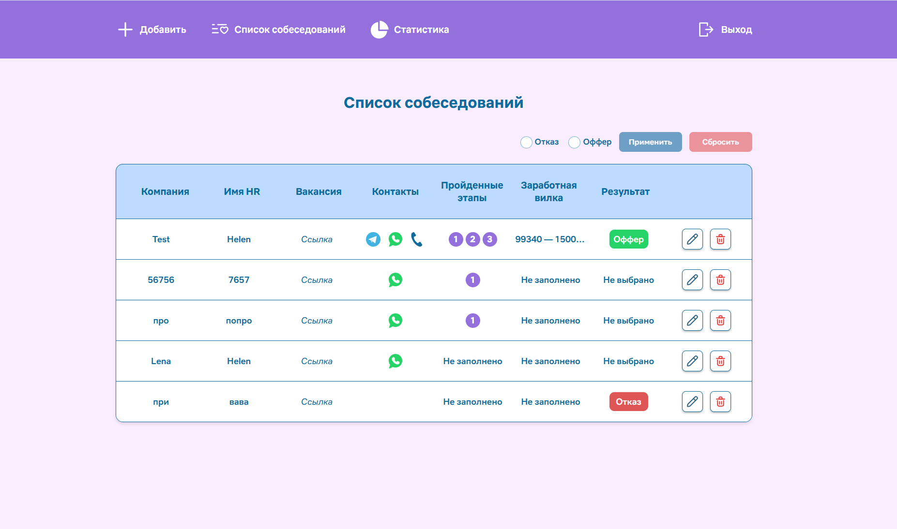

# Interview Tracker

Приложение для учёта собеседований: компании, контакты HR, этапы отбора, зарплатная вилка и итог. Статистика по офферам и отказам выводится в виде диаграммы.

🔗 **Демо:** [interviews-tracker.netlify.app](https://interviews-tracker.netlify.app/)



## Стек

- **Vue 3** (Composition API, `<script setup>`) + **TypeScript**
- **Pinia** — хранение данных пользователя
- **Vue Router** — маршрутизация с защитой страниц (navigation guards)
- **Firebase Authentication** — регистрация и вход по email
- **Cloud Firestore** — хранение собеседований, у каждого пользователя своя коллекция
- **Chart.js / vue-chartjs** — диаграмма статистики
- **Vite**, **ESLint**, **Prettier**

## Возможности

- Регистрация и авторизация; неавторизованный пользователь не попадает на закрытые страницы
- Добавление собеседования: компания, ссылка на вакансию, имя HR, Telegram / WhatsApp / телефон
- Карточка собеседования: этапы с датами и комментариями, зарплатная вилка, итог (оффер / отказ)
- Список всех собеседований с удалением и подтверждением действия
- Статистика: доля офферов, отказов и собеседований в процессе
- Собственные директивы: маска телефона (`v-phone`) и всплывающие подсказки (`v-tooltip`)
- Типизация данных через интерфейсы TypeScript

## Запуск

```bash
npm install
npm run dev
```

Сборка с проверкой типов:

```bash
npm run build
```
